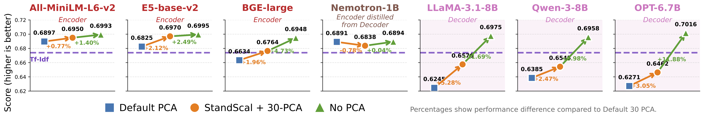
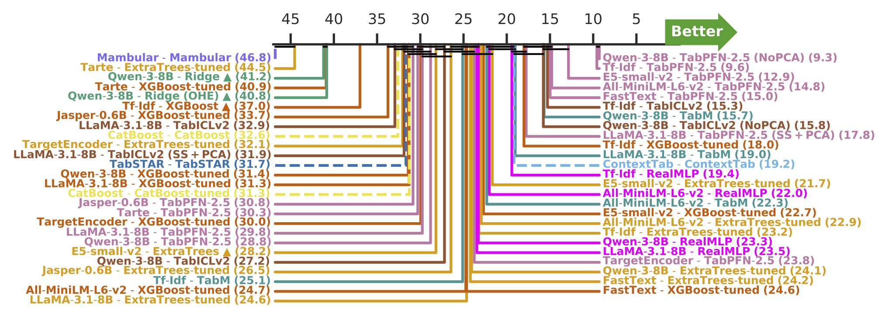
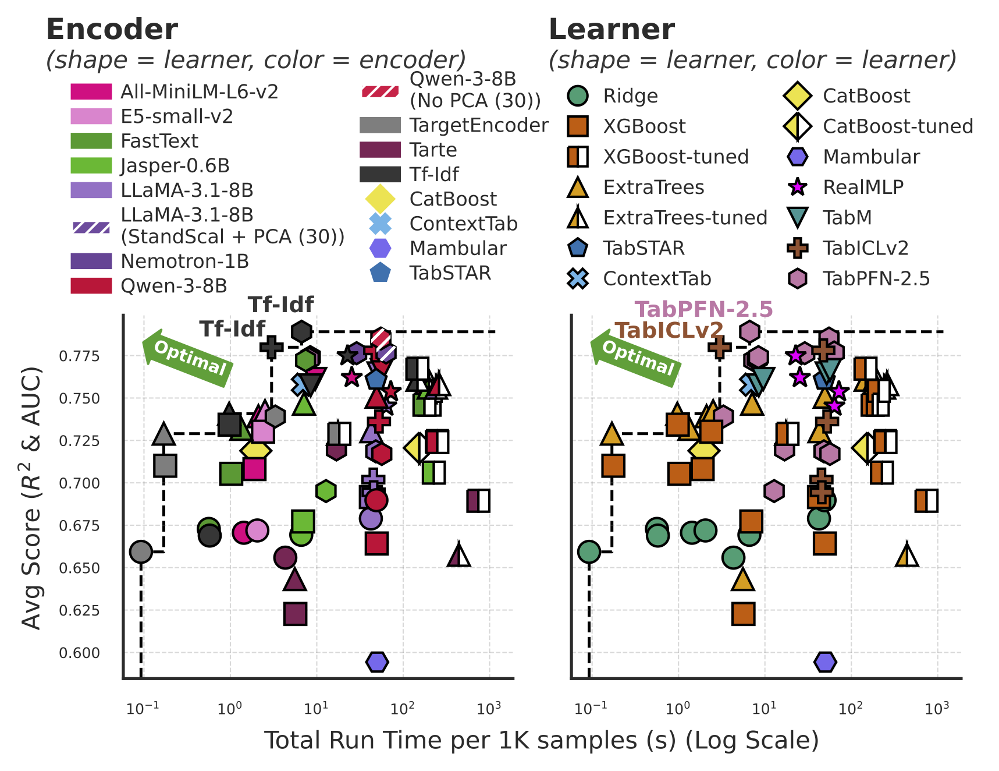
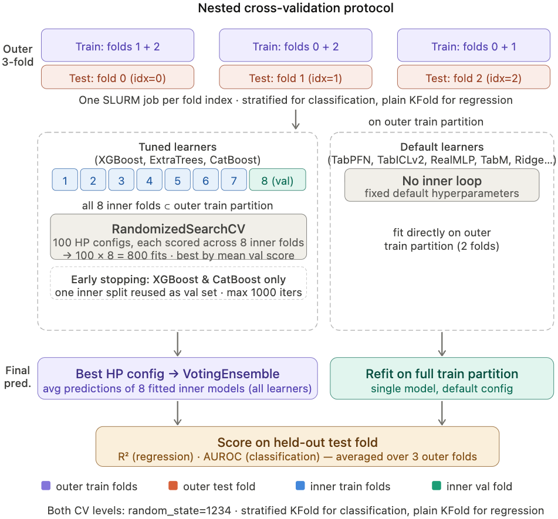

[](https://huggingface.co/datasets/inria-soda/STRABLE-benchmark)
[](https://arxiv.org/abs/2605.12292)
[](https://gblayer.github.io/strable-leaderboard/)
[](https://github.com/soda-inria/strable/blob/main/AGENTS.md)

# STRABLE: Benchmarking Tabular Machine Learning with Strings

> **TL;DR** — STRABLE is a benchmark of **108 real-world tables with strings**. We evaluate **modular pipelines** (a string encoder feeding a tabular learner) as well as **end-to-end** architectures that jointly model strings and numbers.

## 🔑 Key findings

- **Decoder-only LLM embeddings need the right post-processing — i.e. dimensionality reduction.** Default PCA hurts them; standard-scaling-then-PCA, or no-PCA (slicing the first N raw embedding dimensions), recovers their performance.



- **Modular pipelines outperform today's end-to-end string-tabular architectures**.



- **Lightweight encoders paired with advanced learners dominate the Pareto frontier (the best performance-vs-runtime trade-off)** — a consequence of STRABLE's string taxonomy: Categoricals 49%, Names 23%, Structured Codes 17%, Datetimes 2%, Identifiers 0.5% and only **8%** Free Text.



---

## 📦 Install and use

```bash
pip install strable
```

```python
import strable
from sklearn.ensemble import HistGradientBoostingRegressor
from sklearn.pipeline import make_pipeline

X, y, task = strable.load_table("beer-ratings")    # downloaded from Hugging Face once, then cached
folds = strable.get_folds("beer-ratings")          # the benchmark's 3 (train_idx, test_idx) folds

pipeline = make_pipeline(strable.encoders.tfidf(), HistGradientBoostingRegressor())
scores = strable.evaluate(pipeline, tables=["beer-ratings"])   # one row per fold: R² or ROC-AUC
print(scores[["table", "fold", "score"]])

columns, mix = strable.profile(X)                  # type of each string column, and the table's mix
```

`strable.list_tables()` names the 108 tables (`list_tables("regression")`, `"classification"`, …). `evaluate` uses the [leaderboard](https://gblayer.github.io/strable-leaderboard/)'s folds, metrics and checks; with no `tables`, it runs every regression table for a regressor and every classification table for a classifier. Scores can move slightly with other library versions: SciPy 1.17 and later shift the Tf-Idf features by about 1e-7, and learners change across scikit-learn versions. The leaderboard's environment has scikit-learn 1.7.2, SciPy 1.16.3 and skrub 0.7.0. The tables are public, so no Hugging Face token is needed. On its first call, `profile` downloads NLTK's `words` and `stopwords` corpora (about 800 KB) if they are missing. The package does not include the paper's experiments: for those, set up the full environment of Step 1 below.

---

## 🗂️ Repository layout

```text
strable/
├── configs/
│   ├── exp_configs.py
│   ├── model_parameters.py
│   ├── paper_runs.py                   # Runs (<ABLATION>/<save_dir>) each paper figure reads
│   └── path_configs.py
├── data/
│   └── download_datasets.py
├── figures/
│   ├── _main.py
│   ├── pareto_plot.png
│   ├── main_paper/
│   └── appendix/
├── scripts/
│   ├── download_datasets.py
│   ├── compile_results.py
│   ├── compile_results_llm_times.py
│   ├── datasets_metadata_recap.py
│   ├── datasets_representation.py
│   ├── embedding_extraction_scripts/
│   ├── evaluate_scripts/
│   ├── script_preprocess_data/
│   ├── script_data_modification/
│   ├── natural_language_test_VSE_vs_STRABLE_vs_CARTE_vs_TTB.py
│   ├── OHE_vs_passthrough_analysis_xgb.py
│   └── qwen-3-8b_matrioska_embedding_check.py
├── src/
│   ├── encoding.py
│   ├── llm_encoder.py
│   ├── inference.py
│   ├── param_search.py
│   ├── utils_evaluation.py
│   ├── utils_preprocess.py
│   └── utils_visualization.py
├── strable/                            # the pip package: tables, folds, evaluate, Tf-Idf, profile
├── tests/                              # tests of the package (pytest)
├── requirements.txt
├── pyproject.toml
└── LICENSE
```

`results/`, `results_pics/`, `results_tables/`, `results_compiled/`, and `data/data_processed*` are runtime-generated and gitignored. The repository ships no results CSV: every figure input is produced by the pipeline below.

---

## 🛠️ Step 1 – Install

Python **3.12**.

```bash
python3 -m venv .venv && source .venv/bin/activate
pip install -r requirements.txt
export STRABLE_ROOT=$(pwd)
export HF_TOKEN=hf_<your-token>
```

`HF_HOME` controls the Hugging Face cache (default `~/.cache/huggingface`).

> **TabPFN-2.5** — the `tabpfn` and `realtabpfn` learners load the paper's checkpoints from `data/models/tabpfn_2_5/` (Prior Labs' licence applies):
> ```bash
> hf download Prior-Labs/tabpfn_2_5 --revision 6c45f3a6d0d07c6c5f62572e04a0c2929de91b8b --local-dir data/models/tabpfn_2_5 \
>     tabpfn-v2.5-classifier-v2.5_default.ckpt tabpfn-v2.5-regressor-v2.5_default.ckpt \
>     tabpfn-v2.5-classifier-v2.5_real.ckpt tabpfn-v2.5-regressor-v2.5_real.ckpt
> ```

> **ContextTab** is not on PyPI: `requirements.txt` installs it (`sap_rpt_oss`) from <https://github.com/SAP-samples/sap-rpt-1-oss> at the commit the paper used, so `pip` needs `git`.

---

## 💾 Step 2 – Get the data

Paths are wired automatically through [`configs/path_configs.py`](https://github.com/soda-inria/strable/blob/main/configs/path_configs.py).

### 2a. Default variant (Hugging Face) — 🤗

The main benchmark (108 preprocessed tables) is mirrored on the [`inria-soda/STRABLE-benchmark`](https://huggingface.co/datasets/inria-soda/STRABLE-benchmark) Hugging Face repository.

```bash
python data/download_datasets.py
```

This populates `data/data_processed/`.

### 2b. Ablation variants (Google Drive)

The three ablation variants are released as a single Drive bundle:

📦 <https://drive.google.com/file/d/1wq2edCjNUGi2uBwAKgGj5eikswmFxFEZ/view?usp=sharing>

| Variant CLI flag | Folder | Used by |
|---|---|---|
| `default` | `data/data_processed/` | `script_evaluate.py`, `script_evaluate_30_thres_*.py`, `script_evaluate_impute_missing_val.py` |
| `full` | `data/data_processed_FULL/` | `script_evaluate_FULL.py` |
| `feature-eng` | `data/data_processed_feature_eng/` | `script_evaluate_feature_eng.py` |
| `raw-targets` | `data/data_processed_skewness_inverse_transformation/` | `script_evaluate_skewness.py` |

```bash
python scripts/download_datasets.py                                           # default only
python scripts/download_datasets.py --variants default,full,feature-eng,raw-targets
```

### 2c. Re-running preprocessing from raw sources 🛠️

The Drive bundle does not include upstream raw files. To regenerate:

1. Get raw sources from the URLs in **Appendix C.4** of the paper.
2. Drop them under `<STRABLE_ROOT>/data/data_raw/`, at the path each script's `data_path = …` names (most scripts read `data/data_raw/<file>`).
3. Run:
   - [`scripts/script_preprocess_data/`](https://github.com/soda-inria/strable/tree/main/scripts/script_preprocess_data) — for the default 108 tables.
   - [`scripts/script_data_modification/script_preprocess_subsample_75k/`](https://github.com/soda-inria/strable/tree/main/scripts/script_data_modification/script_preprocess_subsample_75k) — for the tables subsampled to 75,000.
   - [`scripts/script_data_modification/script_preprocess_feature_eng/feature_engineering_performed/`](https://github.com/soda-inria/strable/tree/main/scripts/script_data_modification/script_preprocess_feature_eng) — `feature-eng` variant for 43 datasets. Runs **on top of** `data/data_processed/` (i.e. after the default preprocessing), not on the raw sources.
   - [`scripts/script_data_modification/apply_inverse_label_transformation.py`](https://github.com/soda-inria/strable/blob/main/scripts/script_data_modification/apply_inverse_label_transformation.py) — `raw-targets` variant: undoes the default skewness transform on regression labels.

### 2d. Benchmarks comparison (CARTE / TTB / VSE)

Required only to reproduce the cross-benchmark appendix Figure E.1.

| Benchmark | Source | Layout |
|---|---|---|
| **CARTE** | [CARTE benchmark](https://tinyurl.com/carte-benchmark) | `data/CARTE_datasets/` |
| **TTB** | <https://github.com/mrazmartin/TextTabBench/tree/main/datasets_notebooks/paper_datasets> | `data/TTB_datasets/paper_datasets/` |
| **VSE** | <https://figshare.com/articles/dataset/Datasets_with_text_entries/24879042?file=43775007> | `data/VSE_datasets/` |

---

## 🚦 Pipeline

1. **Data** (Step 2 above).
2. **Pre-compute LLM embeddings** — only for LLM-encoder pipelines. Non-LLM encoders (TableVectorizer / TargetEncoder / Tf-Idf) and end-to-end learners (ContextTab / TabSTAR / Mambular / Catboost) do **not** need this step:
   ```bash
   python scripts/embedding_extraction_scripts/script_extract_llm_embeddings.py \
       -m llm-qwen3-8b -dn all-wide -ns 3 -fi all -dv cuda -cf False -oc False
   ```
   GPU memory: the 8B encoders (Qwen-3-8B, LLaMA-3.1-8B) run in float32, as in the paper, so their weights alone take 30 to 32 GB; use a GPU with at least 40 GB (e.g. A40, A100). When a batch does not fit, the script retries with half the batch.
3. **Run the experiment.** Each `scripts/evaluate_scripts/script_evaluate*.py` writes under an ablation folder: `script_evaluate.py` under `default`, or `no-pca` with `--no_pca True`; each other script under its hard-coded `ABLATION` tag (`ct30-ohe`, `ct30-passthrough`, `feature-eng`, `full-data`, `imputed`, `no-target-transform`).

   

   Output lands at:

   ```
   results/<ABLATION>/<save_dir>/<dataset>/<method_marker>/score/<marker>.csv
   ```

   Each variant takes the same core flags (`-dn -ns -m -fi -dv -cf -oc -ti -sd -norm -nopca -ndim`); `script_evaluate.py` also takes `--dry-run`, and `script_evaluate_impute_missing_val.py` adds `-mvp/--missing_val_policy`.

   ```bash
   python scripts/evaluate_scripts/script_evaluate.py \
       --save_dir benchmark_main -m num-str_tabvec_xgb \
       -dn all-wide -ns 3 -fi all -dv cpu -cf False -oc False -ti default
   ```
4. **Compile per-fold scores**:
   ```bash
   python scripts/compile_results.py default/benchmark_main
   # → results/compiled_results/result_default_benchmark_main.csv
   ```
   The output name is always `result_<run name with "/" → "_">.csv` (`compiled_results_path()` in [`configs/path_configs.py`](https://github.com/soda-inria/strable/blob/main/configs/path_configs.py)).
5. **Figures**: one script per figure, runnable independently. Scripts read benchmark results only from compiled runs; the runs they need (run name, script, flags, methods) are listed once in [`configs/paper_runs.py`](https://github.com/soda-inria/strable/blob/main/configs/paper_runs.py). `python configs/paper_runs.py` prints the evaluate + compile commands for all of them. A figure needs the compiled results of every run it reads, so the figures come after the full benchmark. They also read per-table statistics (rows, columns, cardinality, string length, missing values) that `scripts/datasets_representation.py` writes once to `dataset_summary_wide.parquet`.
   ```bash
   python scripts/datasets_representation.py
   python figures/main_paper/figure_3.py
   python figures/appendix/figure_E10.py
   ```
   Outputs land in `results_pics/<YYYY-MM-DD>/` (tables in `results_tables/<YYYY-MM-DD>/`).

---

## ⚡ Quickstart pipelines

Each block below is copy-paste runnable. Adjust `-dv cpu/cuda` for your hardware.

### 1. Fresh-environment setup

```bash
python3 -m venv .venv && source .venv/bin/activate
pip install -r requirements.txt
export STRABLE_ROOT=$(pwd)
export HF_TOKEN=hf_<your-token>
python scripts/download_datasets.py
```

### 2. Embedding extraction with a light LLM

```bash
python scripts/embedding_extraction_scripts/script_extract_llm_embeddings.py \
    -m llm-all-MiniLM-L6-v2 \
    -dn yelp_business beer-ratings \
    -ns 3 -fi all -dv cpu -cf False -oc False
```

### 3. End-to-end learner on one dataset

```bash
python scripts/evaluate_scripts/script_evaluate.py \
    --save_dir benchmark_main -m num-str_contexttab_contexttab \
    -dn yelp_business -ns 3 -fi 0 \
    -dv cpu -cf False -oc False -ti default
python scripts/compile_results.py default/benchmark_main
```

### 4. Light learner, tuned, on a few datasets

```bash
python scripts/evaluate_scripts/script_evaluate.py \
    --save_dir benchmark_main -m num-str_tabvec_xgb \
    -dn yelp_business beer-ratings ramen-ratings \
    -ns 3 -fi all -dv cpu -cf False -oc False -ti tune
python scripts/compile_results.py default/benchmark_main
```

### 5. Foundation-model learner with a light encoder

```bash
python scripts/evaluate_scripts/script_evaluate.py \
    --save_dir benchmark_main -m num-str_tabvec_tabpfn \
    -dn yelp_business beer-ratings ramen-ratings \
    -ns 3 -fi all -dv cuda -cf False -oc False -ti default
python scripts/compile_results.py default/benchmark_main
```

### 6. No-PCA ablation (Fig. 2, E.2)

The no-PCA path is a flag on the main script; `--no_pca True` keeps the first `--n_dimensions` raw embedding dimensions instead of running PCA. Re-uses the same embeddings as the default run; only the dimensionality-reduction step differs. Results land under `results/no-pca/...`.

```bash
python scripts/evaluate_scripts/script_evaluate.py \
    --save_dir benchmark_main -m num-str_llm-qwen3-8b_tabpfn \
    -dn all-wide -ns 3 -fi all \
    -dv cuda -cf False -oc False -ti default \
    --no_pca True
python scripts/compile_results.py no-pca/benchmark_main
```

### 7. CT=30 routing (Fig. E.11)

Routes string columns with cardinality `<30` through one-hot encoding (Ridge) or passthrough (XGBoost / TabPFN); columns with cardinality `≥30` still go through the LLM encoder. Two scripts, one per learner family:

```bash
# LLaMA-3.1-8B embeddings, read by both branches (a gated model: accept its licence on Hugging Face, set HF_TOKEN)
python scripts/embedding_extraction_scripts/script_extract_llm_embeddings.py \
    -m llm-llama-3.1-8b -dn all-wide -ns 3 -fi all -dv cuda -cf False -oc False

# OHE branch (Ridge)
python scripts/evaluate_scripts/script_evaluate_30_thres_OHE.py \
    --save_dir benchmark_main -m num-str_llm-llama-3.1-8b_ridge \
    -dn all-wide -ns 3 -fi all -dv cuda -cf False -oc False -ti default
python scripts/compile_results.py ct30-ohe/benchmark_main

# Passthrough branch (XGBoost / TabPFN)
python scripts/evaluate_scripts/script_evaluate_30_thres_lowcard_passthrough.py \
    --save_dir benchmark_main -m num-str_llm-llama-3.1-8b_xgb \
    -dn all-wide -ns 3 -fi all -dv cuda -cf False -oc False -ti default
python scripts/compile_results.py ct30-passthrough/benchmark_main
```

### 8. Full-data ablation (Fig. E.10)

Reads from `data/data_processed_FULL/` (un-subsampled tables); requires the matching embeddings extracted via the FULL-variant script.

```bash
python scripts/embedding_extraction_scripts/script_extract_llm_embeddings_FULL.py \
    -m llm-all-MiniLM-L6-v2 -dn all-wide -ns 3 -fi all -dv cuda -cf False -oc False

python scripts/evaluate_scripts/script_evaluate_FULL.py \
    --save_dir benchmark_main -m num-str_llm-all-MiniLM-L6-v2_xgb \
    -dn all-wide -ns 3 -fi all -dv cuda -cf False -oc False -ti default
python scripts/compile_results.py full-data/benchmark_main
```

### 9. Feature-engineering ablation (Fig. E.7)

Reads from `data/data_processed_feature_eng/`. Requires running the feature-eng-variant embedding script first.

```bash
python scripts/embedding_extraction_scripts/script_extract_llm_embeddings_feat_eng.py \
    -m llm-all-MiniLM-L6-v2 -dn all-wide -ns 3 -fi all -dv cuda -cf False -oc False

python scripts/evaluate_scripts/script_evaluate_feature_eng.py \
    --save_dir benchmark_main -m num-str_llm-all-MiniLM-L6-v2_xgb \
    -dn all-wide -ns 3 -fi all -dv cuda -cf False -oc False -ti default
python scripts/compile_results.py feature-eng/benchmark_main
```

### 10. Raw-target ablation (Fig. E.8)

Reads from `data/data_processed_skewness_inverse_transformation/`, where the default skewness transform on regression labels has been inverted back to the raw target.

```bash
python scripts/evaluate_scripts/script_evaluate_skewness.py \
    --save_dir benchmark_main -m num-str_tabvec_xgb \
    -dn all-wide -ns 3 -fi all -dv cpu -cf False -oc False -ti default
python scripts/compile_results.py no-target-transform/benchmark_main
```

### 11. Imputation ablation (Fig. E.9)

Adds `-mvp/--missing_val_policy` (`uniform_impute` or `none`). Mean imputation for numeric columns and mode for categorical, applied **after** the train/test split.

```bash
python scripts/evaluate_scripts/script_evaluate_impute_missing_val.py \
    --save_dir benchmark_main -m num-str_tabvec_xgb \
    -dn all-wide -ns 3 -fi all -dv cpu -cf False -oc False -ti default \
    -mvp uniform_impute
python scripts/compile_results.py imputed/benchmark_main
```

### 12. Dry-run on one dataset / one fold

```bash
python scripts/evaluate_scripts/script_evaluate.py --dry-run \
    --save_dir benchmark_main -m num-str_tabvec_ridge \
    -dn yelp_business -ns 3 -fi 0 \
    -dv cpu -cf False -oc False -ti default
```

---

## 🏷️ Method tokens (`-m / --method`)

Method strings have the form `<dtype>_<encoder>_<learner>`. The full enumeration of valid combinations lives in [`scripts/evaluate_scripts/METHOD_NAMES.md`](https://github.com/soda-inria/strable/blob/main/scripts/evaluate_scripts/METHOD_NAMES.md); display-name maps live in [`figures/_main.py`](https://github.com/soda-inria/strable/blob/main/figures/_main.py) (`dtype_map`, `encoder_map`, `learner_map`).

The `_default` / `_tune` suffix is appended automatically based on `-ti / --tune_indicator`; do **not** put it in `-m`. `scripts/compile_results.py` adds it to the compiled `method` column (e.g. `num-str_tabvec_xgb_tune`) for learners listed in `estim_configs` ([`configs/exp_configs.py`](https://github.com/soda-inria/strable/blob/main/configs/exp_configs.py)); the other learners keep the bare name (`num-str_contexttab_contexttab`).

---

## 📑 Citation

If you use STRABLE in your work, please cite:

```bibtex
@misc{blayer2026strablebenchmarkingtabularmachine,
      title={STRABLE: Benchmarking Tabular Machine Learning with Strings},
      author={Gioia Blayer and Myung Jun Kim and Félix Lefebvre and Lennart Purucker and Alan Arazi and Eilam Shapira and Roi Reichart and Frank Hutter and Marine Le Morvan and David Holzmüller and Gaël Varoquaux},
      year={2026},
      eprint={2605.12292},
      archivePrefix={arXiv},
      primaryClass={cs.LG},
      url={https://arxiv.org/abs/2605.12292},
}
```

## ⚖️ License

This project is released under the [BSD 3-Clause License](https://github.com/soda-inria/strable/blob/main/LICENSE).
